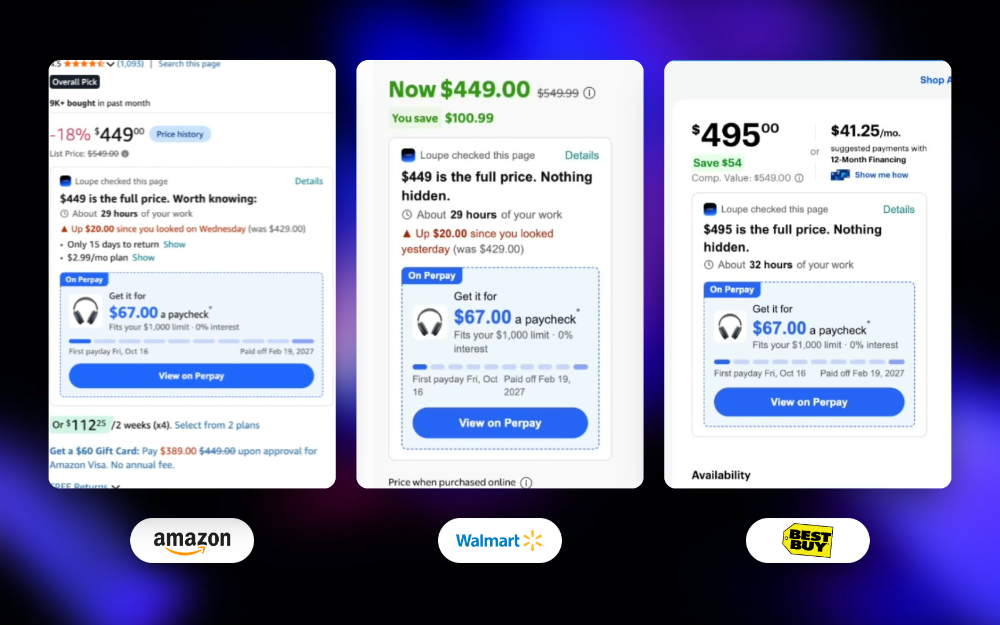
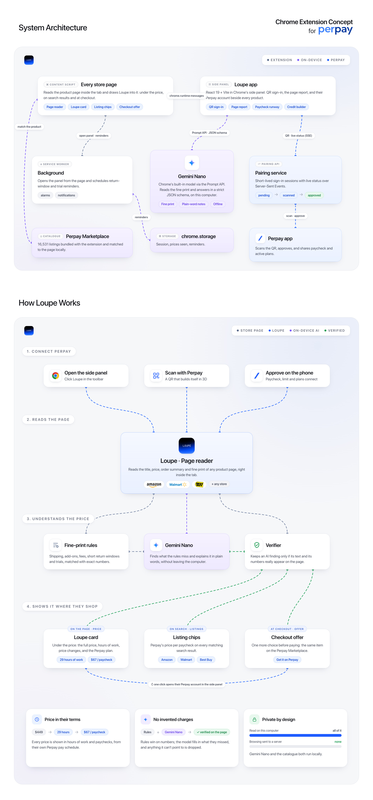

# Loupe

Loupe is a product concept for [Perpay](https://perpay.com): a Chrome side panel that sits alongside the shopping you already do and connects it to your Perpay account.

On Amazon, Walmart, Best Buy and other stores, Loupe reads the product page and explains it in your terms: the full price, how many hours of work it costs, what it looks like per paycheck, and anything in the fine print worth knowing. When the same item is on the Perpay Marketplace, Loupe shows it right under the price, already planned against your pay schedule and spending limit.

> This is a concept project. It is not an official Perpay product and uses demo data only.

[](https://youtu.be/eFXTPHeqPCM)



## What's here

- **Chrome extension** (Manifest V3)
  - **On the store page:** the Loupe card under the price, Perpay chips on search results, an offer at checkout, and in-page notes that highlight the fine print they refer to
  - **Price memory:** remembers what an item cost last time and says when it changed
  - **Side panel:** animated splash, QR sign-in, the full page report, and your Perpay account (paycheck runway, limit planner, credit builder)
  - **Reminders:** Chrome notifications before a return window or trial ends
- **On-device AI**
  - Gemini Nano through Chrome's built-in Prompt API reads the fine print and answers in a strict JSON schema
  - Rules run first, and a verifier keeps an AI finding only if its text and numbers actually appear on the page
- **Perpay Marketplace matching**
  - A bundled snapshot of 16,531 listings, matched to the page on-device by title coverage and model
- **Perpay mobile web app** (installable PWA)
  - Replica of the Perpay home screen
  - In-app camera scanner with a manual code fallback
  - Approve / decline sheet that shares paycheck, limit and active plans with the panel
- **Pairing service**
  - Short-lived pairing sessions with live status over Server-Sent Events (`pending → scanned → approved`)

## How it works



| Piece | Role |
| --- | --- |
| Content script | Reads the product page, matches it against the Marketplace catalogue, and draws the Loupe card, chips, checkout offer and notes into the page |
| Side panel | React app for sign-in, the page report and the Perpay account view; runs the Gemini Nano pass |
| Background service worker | Opens the panel from the page and schedules reminders with `chrome.alarms` |
| Pairing service | Holds sign-in sessions and streams their status to the panel |
| Perpay mobile app | Scans the QR code and approves the sign-in |
| `chrome.storage.local` | Session, prices seen and reminders |

Nothing about the pages you browse leaves the computer: the page reader, product matching and the AI pass all run locally.

## Tech

React 19 · TypeScript · Vite · Tailwind CSS 4 · Framer Motion · Canvas 2D · Chrome Prompt API (Gemini Nano) · `qr-scanner`

## Getting started

Requires Node.js 20+.

```bash
./start.sh
```

This installs dependencies when needed, then runs:

| Service | Address |
| --- | --- |
| Extension build (watch mode) | `dist/extension/` |
| Pairing API | `http://localhost:5175/api` |
| Phone app (same Wi-Fi, HTTPS) | `https://<your-mac-ip>:5176` |

### Load the extension

1. Open `chrome://extensions` and enable **Developer mode**
2. **Load unpacked** → select `dist/extension`
3. Click the Loupe toolbar icon to open the side panel

The panel reloads itself whenever a source file changes.

### Open the phone app

The phone camera requires HTTPS, so `start.sh` serves the app over HTTPS on your local network using a [mkcert](https://github.com/FiloSottile/mkcert) certificate (`brew install mkcert && mkcert -install`).

On each phone, once: open `http://<your-mac-ip>:5177` to install and trust the development certificate. Then open the phone app URL printed by `start.sh` and, optionally, add it to the Home Screen.

Alternatively, `./start.sh --tunnel` exposes the phone app through a Cloudflare quick tunnel (requires `cloudflared`).

### Sign in

Open the Loupe side panel, then in the phone app tap the scan icon in the top bar and point it at the QR code. Approve the request on the phone and the panel signs in.

### On-device AI

The fine-print pass uses Gemini Nano through Chrome's [Prompt API](https://developer.chrome.com/docs/ai/prompt-api). On a supported Chrome, the side panel offers a one-time model download. Where the model isn't available, Loupe falls back to the rules alone.

## Scripts

```bash
npm run dev          # extension watch build
npm run dev:web      # extension UI in the browser (no chrome.* APIs)
npm run dev:mobile   # phone app + pairing API on :5175
npm run build        # production extension build
npm run build:mobile # production phone app build
npm run typecheck
```

## Structure

```
extension/   MV3 manifest and background service worker
src/
  components/  Side panel UI (splash, sign-in, QR renderer, loader, report, insights)
  content/     Content script: Loupe card, listing chips, checkout offer, notes
  lib/         Page reader, fine-print rules, on-device AI, pairing, paycheck math
  data/        Marketplace catalogue loader and product matcher
mobile/      Perpay phone app (home, scanner, approval)
server/      Pairing service (mounted into the phone app's dev server)
public/      Icons, fonts and the bundled Marketplace catalogue
scripts/     Catalogue builder, Wi-Fi HTTPS proxy and terminal QR helper
start.sh     Development launcher
docs/        README images
```

## Links

- **Demo video:** [youtu.be/eFXTPHeqPCM](https://youtu.be/eFXTPHeqPCM)
- **Case study:** [heysam.dev/works/loupe](https://heysam.dev/works/loupe)
